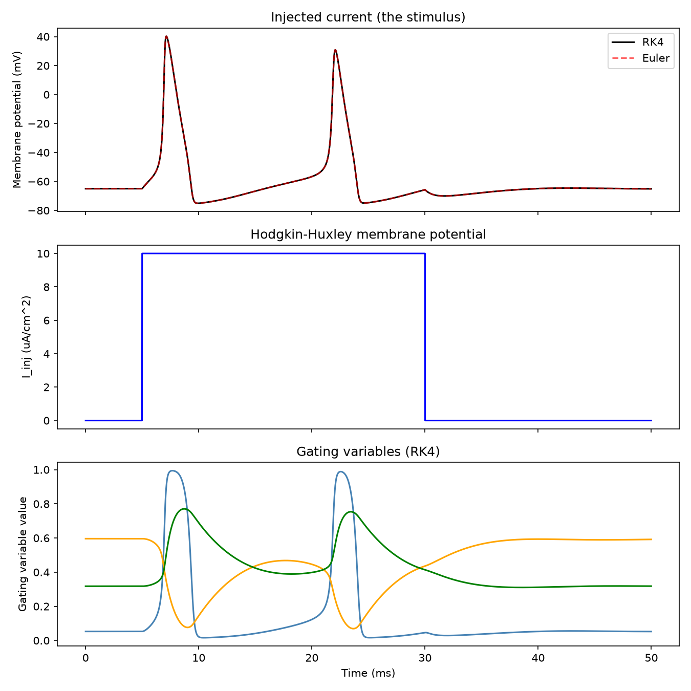
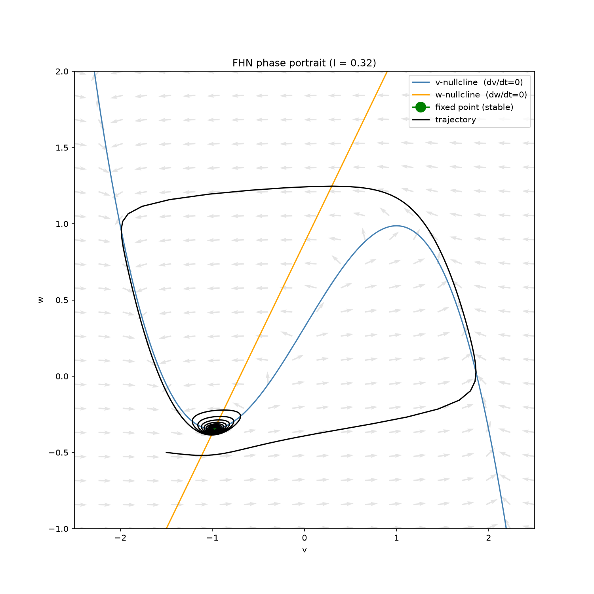
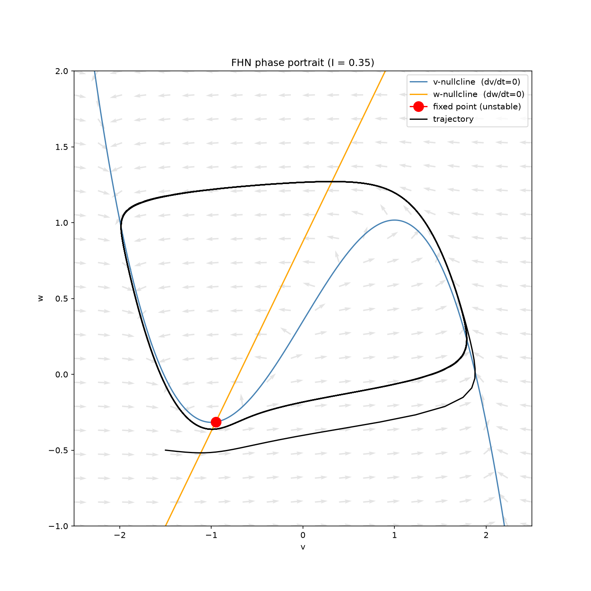
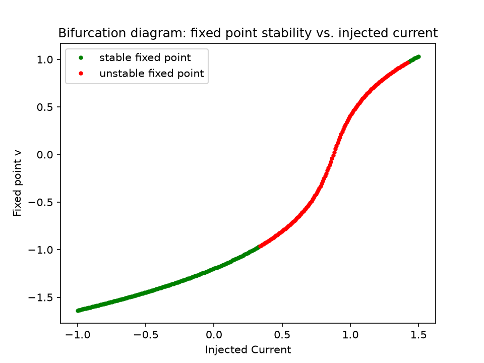
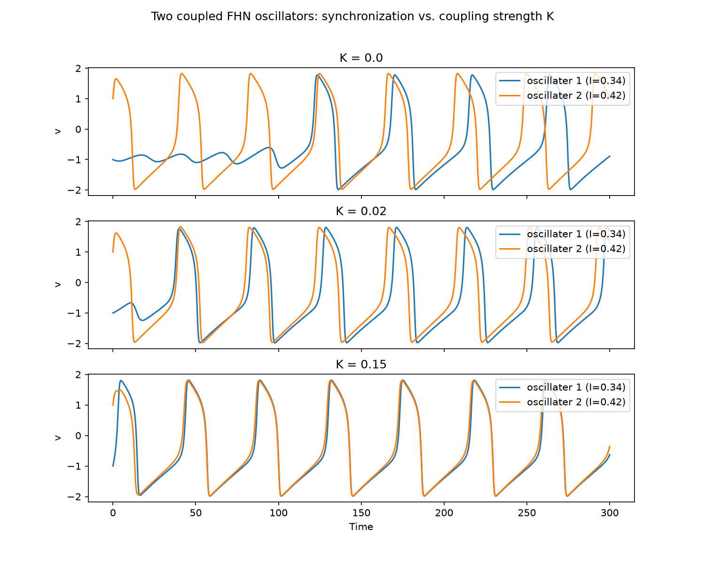
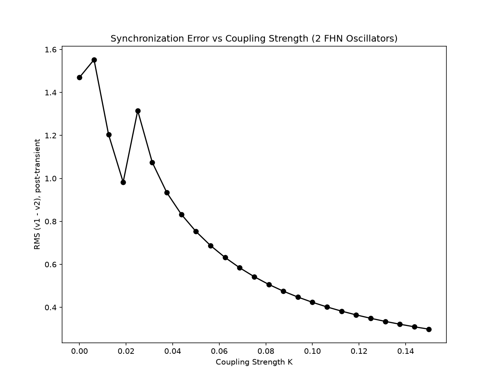
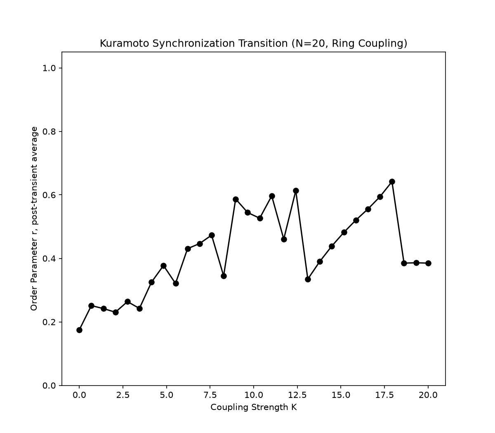
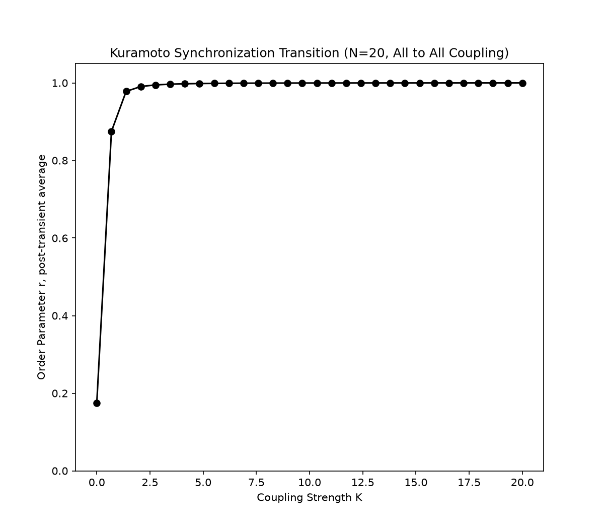

# Hodgkin-Huxley Neuron Modeling: From Single Spikes to Network Synchronization

An independent research project implementing the Hodgkin-Huxley (1952) neuron
model from first principles, and extending it toward dynamical systems
analysis, coupled-neuron synchronization, and a channelopathy-inspired
research question.

## Project roadmap

- [x] **Stage 1 — Single neuron:** Numerically integrate the 4 coupled HH
  
      ODEs (Euler vs. RK4), reproduce the action potential, validate against
      known qualitative behavior (threshold, refractory period).
- [x] **Stage 2 — Dynamical systems analysis:** Reduce to the 2D
  
      FitzHugh-Nagumo model, phase-plane analysis, nullclines, Jacobian
      linearization, bifurcation diagram vs. injected current.
- [x] **Stage 3 — Network synchronization:** Couple multiple HH neurons /
  
      Kuramoto oscillators, study how coupling strength and topology affect
      synchronization.
- [ ] **Stage 4 — Original question:** Simulate a channelopathy (perturbed
  
      ion channel conductance) and characterize its effect on single-neuron
      excitability and network-level synchronization.

## Repository structure

```
hodgkin-huxley-neuron/
├── src/hh_model/           # Core package (the physics + numerics)
│   ├── constants.py        # Biophysical constants
│   ├── kinetics.py         # Gating variable alpha/beta functions
│   ├── model.py             # The 4-ODE vector field
│   ├── integrators.py      # Euler and RK4 integrators (generic over any ODE system)
│   ├── stimuli.py          # Injected-current stimulus functions
│   ├── reduced_models.py   # FitzHugh-Nagumo: vector field, nullclines, Jacobian analysis
│   └── networks.py         # Coupled FHN oscillators, Kuramoto model, order parameter
├── scripts/                # Runnable entry points for each stage
│   ├── run_stage1_single_spike.py
│   ├── run_stage2_phase_plane.py
│   └── run_stage3_synchronization.py
├── tests/                  # Automated correctness checks (pytest)
├── notebooks/              # Exploratory analysis, figures for writeup
├── results/figures/        # Generated plots
├── docs/lab_notebook.md    # Dated research log
└── requirements.txt
```

## Installation

```bash
git clone https://github.com/bzhu-neuro/hodgkin-huxley-neuron.git
cd hodgkin-huxley-neuron
python -m venv venv             # prefer to use Miniconda to manage
source venv/bin/activate        # on Windows: venv\Scripts\activate.bat
pip install -r requirements.txt
pip install -e .                # installs hh_model in editable mode
```

## Usage

```bash
# Run Stage 1: single neuron spike, RK4 vs Euler comparison
python scripts/run_stage1_single_spike.py

# Run Stage 2: FHN phase portrait + bifurcation diagram
python scripts/run_stage2_phase_plane.py

# Run Stage 3: coupled FHN synchronization + Kuramoto transition
python scripts/run_stage3_synchronization.py

# Run the test suite
pytest tests/ -v
```
## Result
Single Spike



Phase Plane

Stable Fixed Point


Unstable Fixed Point


Bifurcation Diagram


Synchronization

Increasing Coupling


Synchronization Error


Ring Synchronization


All to All Synchronization


## Background

The Hodgkin-Huxley model (Hodgkin & Huxley, 1952, *J Physiol* 117:500-544)
describes the membrane of an excitable cell as an electrical circuit: a
capacitor (the lipid bilayer) in parallel with voltage-gated sodium,
potassium, and leak conductances. It remains the foundational biophysical
model for how neurons generate action potentials, and this project builds
up from it toward questions in network neuroscience and computational
medicine (specifically, how single ion-channel dysfunction propagates to
network-level dynamics — relevant to certain epilepsies).

## Status

Active, independent research project. See `docs/lab_notebook.md`
for the dated research log.

## References

- [A QUANTITATIVE DESCRIPTION OF MEMBRANE CURRENT AND ITS APPLICATION TO CONDUCTION AND EXCITATION IN NERVE](https://www.damtp.cam.ac.uk/user/gold/pdfs/teaching/HodgkinHuxley.pdf)

- [DYNAMICAL SYSTEMS IN NEUROSCIENCE: THE GEOMETRY OF EXCITABILITY AND BURSTING by EUGENE M. IZHIKEVICH](https://www.izhikevich.org/publications/dsn.pdf)

- [Nonlinear Dynamics and Chaos Third Edition by STEVEN A. STROGATZ]()

## License

MIT — see `LICENSE`.
